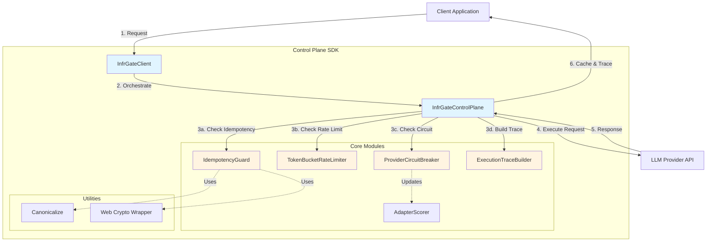
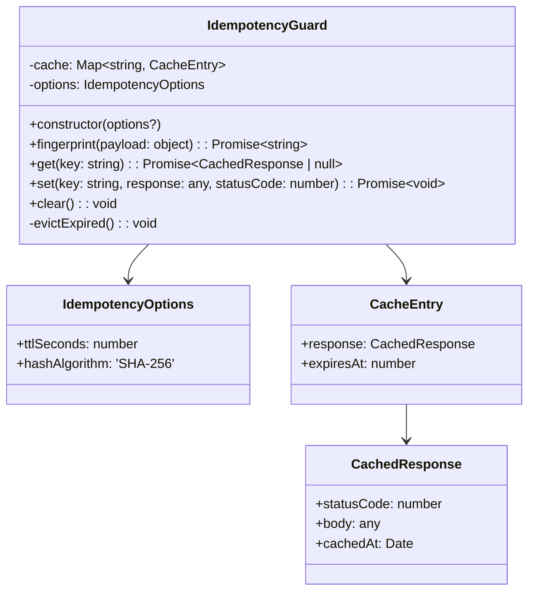
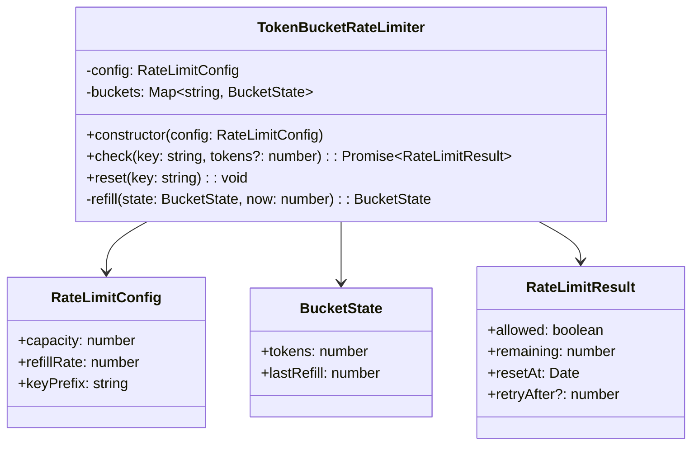
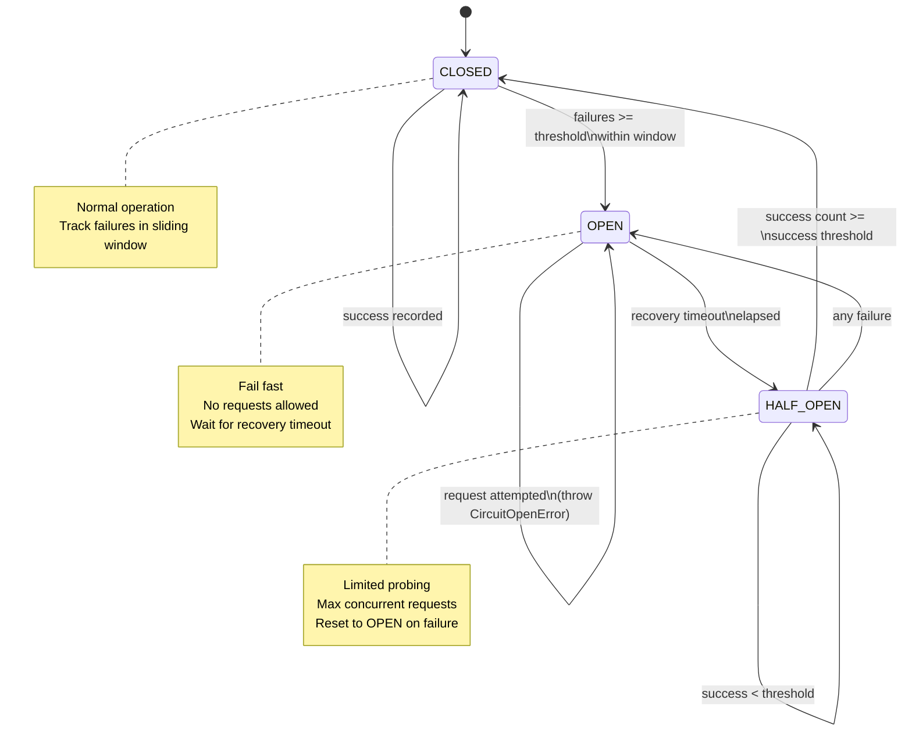
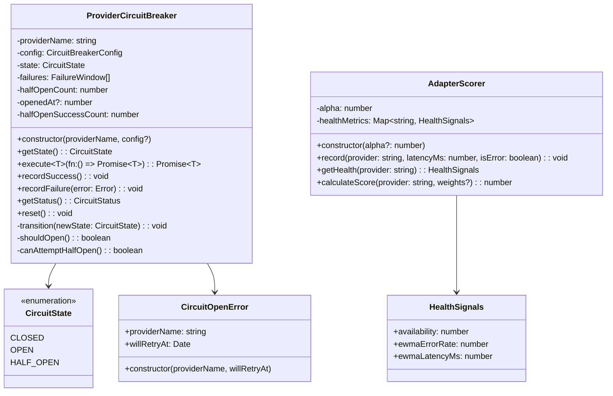
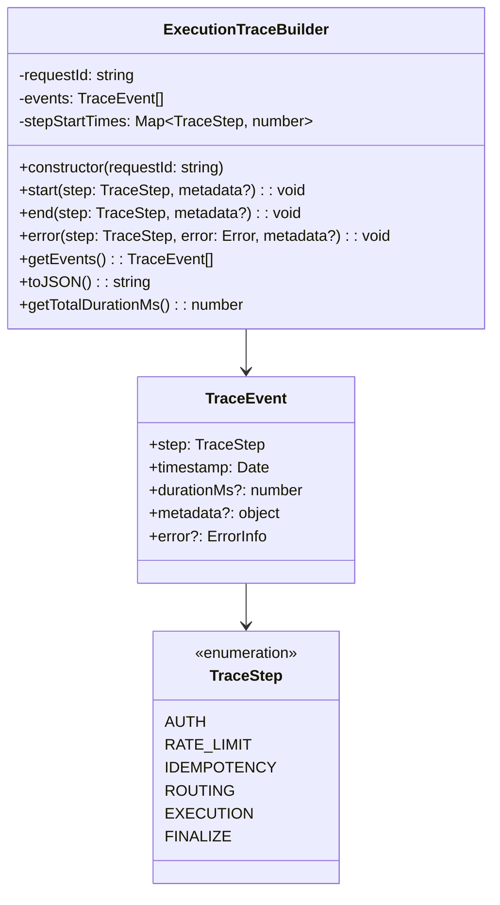
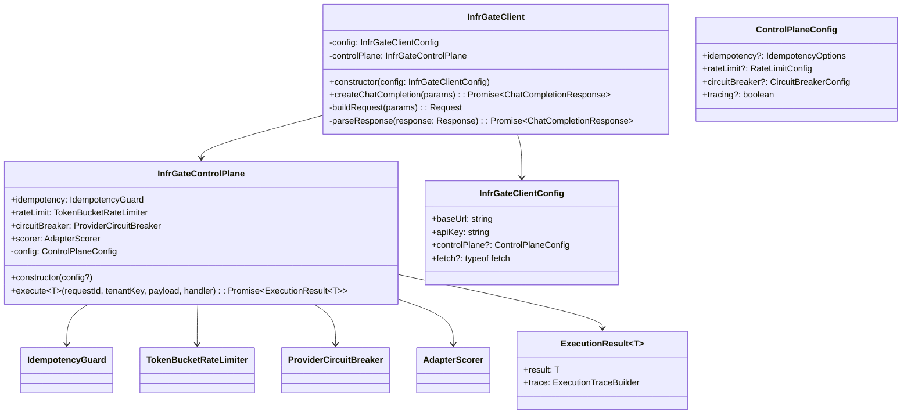
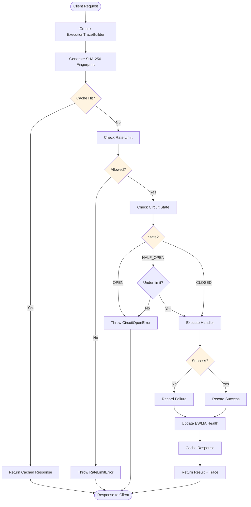

# Design Document

**Feature Name:** `typescript-control-plane-sdk`  
**Status:** Draft  
**Created:** 2024-01-XX  
**Last Updated:** 2024-01-XX

---

## 1. System Architecture

### 1.1 High-Level Overview

The TypeScript Control Plane SDK provides a zero-dependency, tree-shakeable library that encapsulates InfrGate's core reliability primitives for JavaScript/TypeScript applications. The SDK enables developers to build production-grade LLM gateways with idempotency, rate limiting, circuit breaking, and distributed tracing capabilities.



### 1.2 Module Interaction Flow

The SDK processes requests through a six-step control plane pipeline:


### 1.3 Design Principles

1. **Zero Runtime Dependencies**: No external packages required at runtime; all functionality implemented using native APIs
2. **Tree-Shakeable ESM**: Modern bundlers can eliminate unused code paths
3. **Type-Safe**: Full TypeScript coverage with strict mode enabled
4. **Platform Agnostic**: Works in Node.js 16+, browsers, and edge runtimes
5. **Fail-Safe Defaults**: In-memory storage with graceful degradation
6. **Observable**: Comprehensive tracing and health scoring for production debugging

---

## 2. Module Design

### 2.1 Idempotency Module (`idempotency.ts`)

#### 2.1.1 Class Diagram



#### 2.1.2 Data Structures

**In-Memory Cache Schema:**
```typescript
Map<string, {
  response: {
    statusCode: number;
    body: any;
    cachedAt: Date;
  };
  expiresAt: number; // Unix timestamp in ms
}>
```

**Cache Eviction Strategy:**
- **Lazy Eviction**: Check expiration on `get()` operations
- **Proactive Cleanup**: Optional background interval (not implemented in v0.2.0)
- **Memory Bounds**: No max size limit (document TTL best practices)

#### 2.1.3 Fingerprinting Algorithm

```typescript
/**
 * 1. Canonicalize JSON (sort keys recursively)
 * 2. Serialize to UTF-8 bytes
 * 3. Compute SHA-256 hash
 * 4. Encode as lowercase hex string
 */
async fingerprint(payload: Record<string, any>): Promise<string> {
  const canonical = canonicalize(payload);
  const encoder = new TextEncoder();
  const data = encoder.encode(canonical);
  const hashBuffer = await crypto.subtle.digest('SHA-256', data);
  return bufferToHex(hashBuffer);
}

function canonicalize(obj: any): string {
  if (obj === null || typeof obj !== 'object') {
    return JSON.stringify(obj);
  }
  if (Array.isArray(obj)) {
    return '[' + obj.map(canonicalize).join(',') + ']';
  }
  const sorted = Object.keys(obj).sort();
  const pairs = sorted.map(k => `"${k}":${canonicalize(obj[k])}`);
  return '{' + pairs.join(',') + '}';
}
```

**Test Vectors:**
```typescript
// Order-independent hashing
fingerprint({ b: 2, a: 1 }) === fingerprint({ a: 1, b: 2 })
// "5d41402abc4b2a76b9719d911017c592" (example hash)

// Nested object handling
fingerprint({ user: { name: "Alice", id: 123 } })
// Produces deterministic hash regardless of key ordering
```

---

### 2.2 Rate Limiter Module (`rate-limiter.ts`)

#### 2.2.1 Class Diagram



#### 2.2.2 Token Bucket Algorithm

**Refill Logic:**
```typescript
function refill(state: BucketState, now: number): BucketState {
  const elapsed = (now - state.lastRefill) / 1000; // ms to seconds
  const tokensToAdd = elapsed * this.config.refillRate;
  const newTokens = Math.min(
    state.tokens + tokensToAdd,
    this.config.capacity
  );
  
  return {
    tokens: newTokens,
    lastRefill: now
  };
}
```

**Consumption Logic:**
```typescript
async check(key: string, tokens: number = 1): Promise<RateLimitResult> {
  const bucketKey = `${this.config.keyPrefix}:${key}`;
  const now = Date.now();
  
  let state = this.buckets.get(bucketKey) ?? {
    tokens: this.config.capacity,
    lastRefill: now
  };
  
  // Refill tokens based on elapsed time
  state = this.refill(state, now);
  
  // Check capacity
  if (state.tokens >= tokens) {
    state.tokens -= tokens;
    this.buckets.set(bucketKey, state);
    
    return {
      allowed: true,
      remaining: Math.floor(state.tokens),
      resetAt: new Date(now + (this.config.capacity / this.config.refillRate) * 1000)
    };
  }
  
  // Rate limited
  const deficit = tokens - state.tokens;
  const retryAfter = Math.ceil(deficit / this.config.refillRate);
  
  return {
    allowed: false,
    remaining: 0,
    resetAt: new Date(now + retryAfter * 1000),
    retryAfter
  };
}
```

**Example Scenarios:**

| Scenario | Capacity | Refill Rate | Request Tokens | Current Tokens | Result |
|----------|----------|-------------|----------------|----------------|--------|
| Cold start | 100 | 10/s | 20 | 100 | ✓ Allowed, remaining: 80 |
| Burst traffic | 100 | 10/s | 150 | 100 | ✗ Denied, retryAfter: 5s |
| Steady state | 60 | 1/s | 1 | 45 | ✓ Allowed, remaining: 44 |
| Partial refill | 60 | 1/s | 1 | 0 (2s ago) | ✓ Allowed (refilled 2 tokens), remaining: 1 |

---

### 2.3 Circuit Breaker Module (`circuit-breaker.ts`)

#### 2.3.1 State Machine



#### 2.3.2 Class Design



#### 2.3.3 Failure Window Tracking

```typescript
interface FailureWindow {
  timestamp: number; // Unix ms
  error: string;
}

// Sliding window implementation
function shouldOpen(): boolean {
  const now = Date.now();
  const windowStart = now - this.config.failureWindowMs;
  
  // Filter to failures within window
  this.failures = this.failures.filter(f => f.timestamp >= windowStart);
  
  return this.failures.length >= this.config.failureThreshold;
}
```

#### 2.3.4 EWMA Health Scoring

**Update Formula:**
```typescript
// α = 0.3 (default smoothing factor)
newValue = α × sample + (1 - α) × currentValue

// Example: Update error rate
const newErrorRate = 0.3 * (isError ? 1 : 0) + 0.7 * currentErrorRate;
```

**Composite Score Calculation:**
```typescript
function calculateScore(
  provider: string,
  weights = { availability: 0.4, errorRate: 0.4, latency: 0.2 }
): number {
  const health = this.getHealth(provider);
  
  // Normalize latency to 0-1 scale (lower is better)
  const latencyScore = 1 - Math.min(health.ewmaLatencyMs / 5000, 1);
  
  const score = 
    weights.availability * health.availability +
    weights.errorRate * (1 - health.ewmaErrorRate) +
    weights.latency * latencyScore;
  
  return Math.max(0, Math.min(1, score)); // Clamp to [0, 1]
}
```

**Health Signal Initialization:**
```typescript
// Cold start values (neutral baseline)
{
  availability: 1.0,        // Assume available until proven otherwise
  ewmaErrorRate: 0.0,       // No errors initially
  ewmaLatencyMs: 1000.0     // Baseline 1s latency
}
```

---

### 2.4 Trace Module (`trace.ts`)

#### 2.4.1 Class Diagram



#### 2.4.2 Trace Event Schema

```typescript
interface TraceEvent {
  step: 'auth' | 'rate_limit' | 'idempotency' | 'routing' | 'execution' | 'finalize';
  timestamp: Date;           // ISO 8601 string when serialized
  durationMs?: number;       // Only present after end()
  metadata?: {
    [key: string]: string | number | boolean;
  };
  error?: {
    type: string;            // Error constructor name
    message: string;         // Error message
  };
}
```

#### 2.4.3 Timing Mechanism

```typescript
// High-precision timing using performance.now()
start(step: TraceStep, metadata?: Record<string, any>): void {
  const startTime = performance.now();
  this.stepStartTimes.set(step, startTime);
  
  this.events.push({
    step,
    timestamp: new Date(),
    metadata
  });
}

end(step: TraceStep, metadata?: Record<string, any>): void {
  const startTime = this.stepStartTimes.get(step);
  if (!startTime) {
    throw new Error(`Step ${step} was never started`);
  }
  
  const durationMs = performance.now() - startTime;
  this.stepStartTimes.delete(step);
  
  // Find the corresponding start event and update it
  const startEvent = this.events.find(
    e => e.step === step && e.durationMs === undefined
  );
  
  if (startEvent) {
    startEvent.durationMs = durationMs;
    if (metadata) {
      startEvent.metadata = { ...startEvent.metadata, ...metadata };
    }
  }
}
```

#### 2.4.4 Example Trace Output

```json
{
  "requestId": "req_abc123",
  "events": [
    {
      "step": "auth",
      "timestamp": "2024-01-15T10:30:00.123Z",
      "durationMs": 2.45,
      "metadata": { "tenantId": "tenant_xyz" }
    },
    {
      "step": "rate_limit",
      "timestamp": "2024-01-15T10:30:00.126Z",
      "durationMs": 0.89,
      "metadata": { "allowed": true, "remaining": 95 }
    },
    {
      "step": "idempotency",
      "timestamp": "2024-01-15T10:30:00.127Z",
      "durationMs": 5.12,
      "metadata": { "cacheHit": false, "fingerprintKey": "a3b5c8..." }
    },
    {
      "step": "execution",
      "timestamp": "2024-01-15T10:30:00.132Z",
      "durationMs": 1245.67,
      "metadata": { "provider": "openai", "model": "gpt-4" }
    },
    {
      "step": "finalize",
      "timestamp": "2024-01-15T10:30:01.378Z",
      "durationMs": 3.21,
      "metadata": { "cached": true }
    }
  ],
  "totalDurationMs": 1257.34
}
```

---

### 2.5 Client Module (`client.ts`)

#### 2.5.1 Component Architecture



#### 2.5.2 Control Plane Orchestration

```typescript
async execute<T>(
  requestId: string,
  tenantKey: string,
  payload: Record<string, any>,
  handler: () => Promise<T>
): Promise<ExecutionResult<T>> {
  const trace = new ExecutionTraceBuilder(requestId);
  
  try {
    // Step 1: Idempotency check
    trace.start(TraceStep.IDEMPOTENCY);
    const idempotencyKey = await this.idempotency.fingerprint(payload);
    const cached = await this.idempotency.get(idempotencyKey);
    if (cached) {
      trace.end(TraceStep.IDEMPOTENCY, { cacheHit: true });
      return { result: cached.body as T, trace };
    }
    trace.end(TraceStep.IDEMPOTENCY, { cacheHit: false, key: idempotencyKey });
    
    // Step 2: Rate limit check
    trace.start(TraceStep.RATE_LIMIT);
    const rateLimitResult = await this.rateLimit.check(tenantKey);
    if (!rateLimitResult.allowed) {
      trace.error(TraceStep.RATE_LIMIT, new Error('Rate limit exceeded'));
      throw new RateLimitError(rateLimitResult.retryAfter);
    }
    trace.end(TraceStep.RATE_LIMIT, { remaining: rateLimitResult.remaining });
    
    // Step 3: Execute with circuit breaker
    trace.start(TraceStep.EXECUTION);
    const result = await this.circuitBreaker.execute(handler);
    trace.end(TraceStep.EXECUTION);
    
    // Step 4: Cache response
    trace.start(TraceStep.FINALIZE);
    await this.idempotency.set(idempotencyKey, result, 200);
    trace.end(TraceStep.FINALIZE);
    
    return { result, trace };
    
  } catch (error) {
    // Error already traced in appropriate step
    throw error;
  }
}
```

#### 2.5.3 OpenAI-Compatible Client Implementation

```typescript
async createChatCompletion(params: ChatCompletionParams): Promise<ChatCompletionResponse> {
  const requestId = `req_${crypto.randomUUID()}`;
  const tenantKey = this.config.apiKey; // Use API key as tenant identifier
  
  const payload = {
    model: params.model,
    messages: params.messages,
    temperature: params.temperature,
    max_tokens: params.maxTokens,
  };
  
  const { result, trace } = await this.controlPlane.execute(
    requestId,
    tenantKey,
    payload,
    async () => {
      const url = `${this.config.baseUrl}/v1/chat/completions`;
      const headers = {
        'Content-Type': 'application/json',
        'Authorization': `Bearer ${this.config.apiKey}`,
      };
      
      if (params.idempotencyKey) {
        headers['Idempotency-Key'] = params.idempotencyKey;
      }
      
      const fetchFn = this.config.fetch ?? fetch;
      const response = await fetchFn(url, {
        method: 'POST',
        headers,
        body: JSON.stringify(payload),
      });
      
      if (!response.ok) {
        throw new Error(`Provider error: ${response.status}`);
      }
      
      return response.json();
    }
  );
  
  return result as ChatCompletionResponse;
}
```

---

## 3. Build System & Tooling

### 3.1 Package Configuration

**package.json:**
```json
{
  "name": "@infrgate/control-plane",
  "version": "0.2.0",
  "type": "module",
  "description": "Zero-dependency TypeScript SDK for InfrGate control plane primitives",
  "main": "./dist/index.js",
  "module": "./dist/index.mjs",
  "types": "./dist/index.d.ts",
  "exports": {
    ".": {
      "types": "./dist/index.d.ts",
      "import": "./dist/index.mjs",
      "require": "./dist/index.js"
    }
  },
  "files": [
    "dist",
    "README.md",
    "LICENSE"
  ],
  "engines": {
    "node": ">=16.0.0"
  },
  "scripts": {
    "build": "tsup",
    "test": "vitest run",
    "test:watch": "vitest",
    "test:coverage": "vitest run --coverage",
    "typecheck": "tsc --noEmit",
    "lint": "eslint src --ext .ts",
    "prepublishOnly": "npm run build && npm test"
  },
  "keywords": [
    "llm",
    "gateway",
    "rate-limiting",
    "circuit-breaker",
    "idempotency",
    "openai",
    "control-plane"
  ],
  "author": "InfrGate Team",
  "license": "MIT",
  "repository": {
    "type": "git",
    "url": "https://github.com/infrgate/infrgate.git",
    "directory": "packages/sdk"
  },
  "devDependencies": {
    "@types/node": "^20.10.0",
    "@typescript-eslint/eslint-plugin": "^6.15.0",
    "@typescript-eslint/parser": "^6.15.0",
    "eslint": "^8.56.0",
    "tsup": "^8.0.1",
    "typescript": "^5.3.3",
    "vitest": "^1.1.0"
  },
  "dependencies": {}
}
```

### 3.2 TypeScript Configuration

**tsconfig.json:**
```json
{
  "compilerOptions": {
    "target": "ES2020",
    "module": "ESNext",
    "lib": ["ES2020", "DOM"],
    "moduleResolution": "bundler",
    "strict": true,
    "esModuleInterop": true,
    "skipLibCheck": true,
    "forceConsistentCasingInFileNames": true,
    "declaration": true,
    "declarationMap": true,
    "sourceMap": true,
    "outDir": "./dist",
    "rootDir": "./src",
    "resolveJsonModule": true,
    "allowSyntheticDefaultImports": true,
    "noUnusedLocals": true,
    "noUnusedParameters": true,
    "noImplicitReturns": true,
    "noFallthroughCasesInSwitch": true
  },
  "include": ["src/**/*"],
  "exclude": ["node_modules", "dist", "tests"]
}
```

### 3.3 Build Configuration (tsup)

**tsup.config.ts:**
```typescript
import { defineConfig } from 'tsup';

export default defineConfig({
  entry: ['src/index.ts'],
  format: ['cjs', 'esm'],
  dts: true,
  splitting: false,
  sourcemap: true,
  clean: true,
  minify: true,
  treeshake: true,
  target: 'es2020',
  outDir: 'dist',
  outExtension({ format }) {
    return {
      js: format === 'cjs' ? '.js' : '.mjs',
    };
  },
});
```

**Build Outputs:**
```
dist/
├── index.js           # CommonJS bundle (minified)
├── index.js.map       # CommonJS source map
├── index.mjs          # ESM bundle (minified)
├── index.mjs.map      # ESM source map
├── index.d.ts         # TypeScript declarations
└── index.d.ts.map     # Declaration source map
```

### 3.4 Test Configuration

**vitest.config.ts:**
```typescript
import { defineConfig } from 'vitest/config';

export default defineConfig({
  test: {
    globals: true,
    environment: 'node',
    coverage: {
      provider: 'v8',
      reporter: ['text', 'json', 'html'],
      exclude: [
        'node_modules/',
        'dist/',
        'tests/',
        '**/*.test.ts',
      ],
      thresholds: {
        lines: 80,
        functions: 80,
        branches: 80,
        statements: 80,
      },
    },
  },
});
```

---

## 4. Crypto Strategy

### 4.1 Web Crypto API Usage

The SDK uses the Web Crypto API (`crypto.subtle`) for all cryptographic operations, providing cross-platform compatibility:

```typescript
// SHA-256 hashing
async function sha256(data: string): Promise<string> {
  const encoder = new TextEncoder();
  const dataBuffer = encoder.encode(data);
  const hashBuffer = await crypto.subtle.digest('SHA-256', dataBuffer);
  return bufferToHex(hashBuffer);
}

function bufferToHex(buffer: ArrayBuffer): string {
  const byteArray = new Uint8Array(buffer);
  return Array.from(byteArray)
    .map(b => b.toString(16).padStart(2, '0'))
    .join('');
}
```

### 4.2 Platform Compatibility Matrix

| Platform | Web Crypto Support | Fallback Needed |
|----------|-------------------|-----------------|
| Node.js 16+ | ✅ `globalThis.crypto.subtle` | No |
| Node.js 15.x | ⚠️ `crypto.webcrypto.subtle` | Import required |
| Node.js <15 | ❌ Not available | Error thrown |
| Chrome 90+ | ✅ `window.crypto.subtle` | No |
| Firefox 88+ | ✅ `window.crypto.subtle` | No |
| Safari 15+ | ✅ `window.crypto.subtle` | No |
| Cloudflare Workers | ✅ `crypto.subtle` | No |
| Deno | ✅ `crypto.subtle` | No |

### 4.3 Crypto Wrapper Implementation

**src/utils/crypto.ts:**
```typescript
/**
 * Cross-platform Web Crypto API wrapper
 * Throws clear error if Web Crypto is unavailable
 */

export class CryptoUnavailableError extends Error {
  constructor() {
    super(
      'Web Crypto API not available. ' +
      'Requires Node.js 16+ or modern browser. ' +
      'For Node.js 15.x, use: import { webcrypto } from "crypto"'
    );
    this.name = 'CryptoUnavailableError';
  }
}

/**
 * Get the crypto.subtle object, throwing if unavailable
 */
export function getSubtleCrypto(): SubtleCrypto {
  // Node.js 16+ / Browser / Edge runtimes
  if (typeof globalThis !== 'undefined' && globalThis.crypto?.subtle) {
    return globalThis.crypto.subtle;
  }
  
  // Node.js 15.x fallback (requires explicit import by user)
  if (typeof global !== 'undefined' && (global as any).crypto?.subtle) {
    return (global as any).crypto.subtle;
  }
  
  throw new CryptoUnavailableError();
}

/**
 * Compute SHA-256 hash of input string
 * @returns Lowercase hex string (64 characters)
 */
export async function sha256(input: string): Promise<string> {
  const subtle = getSubtleCrypto();
  const encoder = new TextEncoder();
  const data = encoder.encode(input);
  const hashBuffer = await subtle.digest('SHA-256', data);
  return bufferToHex(hashBuffer);
}

/**
 * Convert ArrayBuffer to hex string
 */
function bufferToHex(buffer: ArrayBuffer): string {
  const byteArray = new Uint8Array(buffer);
  return Array.from(byteArray)
    .map(byte => byte.toString(16).padStart(2, '0'))
    .join('');
}
```

---

## 5. Data Flow & Request Processing

### 5.1 End-to-End Request Flow



### 5.2 Error Handling Strategy

```typescript
// Error hierarchy
class ControlPlaneError extends Error {
  constructor(message: string) {
    super(message);
    this.name = this.constructor.name;
  }
}

class RateLimitError extends ControlPlaneError {
  retryAfter: number;
  
  constructor(retryAfter: number) {
    super(`Rate limit exceeded. Retry after ${retryAfter}s`);
    this.retryAfter = retryAfter;
  }
}

class CircuitOpenError extends ControlPlaneError {
  providerName: string;
  willRetryAt: Date;
  
  constructor(providerName: string, willRetryAt: Date) {
    super(
      `Circuit breaker open for ${providerName}. ` +
      `Will retry at ${willRetryAt.toISOString()}`
    );
    this.providerName = providerName;
    this.willRetryAt = willRetryAt;
  }
}

class IdempotencyConflictError extends ControlPlaneError {
  constructor(key: string) {
    super(`Request with idempotency key ${key} is already in progress`);
  }
}
```

### 5.3 Metadata Propagation

**Trace Metadata Schema:**
```typescript
// Step-specific metadata
interface StepMetadata {
  // IDEMPOTENCY
  idempotency?: {
    cacheHit: boolean;
    key: string;
    ttlSeconds: number;
  };
  
  // RATE_LIMIT
  rateLimit?: {
    allowed: boolean;
    remaining: number;
    capacity: number;
  };
  
  // EXECUTION
  execution?: {
    provider: string;
    model: string;
    latencyMs: number;
    circuitState: 'CLOSED' | 'OPEN' | 'HALF_OPEN';
  };
  
  // FINALIZE
  finalize?: {
    cached: boolean;
    healthScore: number;
  };
}
```

---

## 6. Public API Reference

### 6.1 Core Exports

```typescript
// packages/sdk/src/index.ts

// Idempotency
export { IdempotencyGuard } from './idempotency.js';
export type { IdempotencyOptions, CachedResponse } from './idempotency.js';

// Rate Limiting
export { TokenBucketRateLimiter } from './rate-limiter.js';
export type { RateLimitConfig, RateLimitResult } from './rate-limiter.js';

// Circuit Breaker
export {
  ProviderCircuitBreaker,
  CircuitState,
  CircuitOpenError,
  AdapterScorer,
} from './circuit-breaker.js';
export type {
  CircuitBreakerConfig,
  CircuitStatus,
  HealthSignals,
} from './circuit-breaker.js';

// Tracing
export { ExecutionTraceBuilder, TraceStep } from './trace.js';
export type { TraceEvent } from './trace.js';

// Client & Orchestration
export {
  InfrGateControlPlane,
  InfrGateClient,
} from './client.js';
export type {
  ControlPlaneConfig,
  InfrGateClientConfig,
  ChatCompletionParams,
  ChatCompletionResponse,
  ExecutionResult,
} from './client.js';

// Errors
export {
  ControlPlaneError,
  RateLimitError,
  IdempotencyConflictError,
} from './errors.js';
```

### 6.2 Type Definitions Summary

**Complete type exports with TSDoc:**

```typescript
/**
 * Options for configuring idempotency guard
 */
export interface IdempotencyOptions {
  /** Cache TTL in seconds (default: 3600) */
  ttlSeconds: number;
  /** Hash algorithm (only SHA-256 supported) */
  hashAlgorithm?: 'SHA-256';
}

/**
 * Cached response entry
 */
export interface CachedResponse {
  /** HTTP status code */
  statusCode: number;
  /** Response body (JSON-serializable) */
  body: any;
  /** Timestamp when cached */
  cachedAt: Date;
}

/**
 * Token bucket rate limiter configuration
 */
export interface RateLimitConfig {
  /** Maximum tokens in bucket */
  capacity: number;
  /** Tokens refilled per second */
  refillRate: number;
  /** Key prefix for namespacing (default: 'ratelimit') */
  keyPrefix?: string;
}

/**
 * Result of rate limit check
 */
export interface RateLimitResult {
  /** Whether request is allowed */
  allowed: boolean;
  /** Tokens remaining after this request */
  remaining: number;
  /** When bucket will refill to capacity */
  resetAt: Date;
  /** Seconds to wait before retry (only when denied) */
  retryAfter?: number;
}

/**
 * Circuit breaker configuration
 */
export interface CircuitBreakerConfig {
  /** Failures before opening circuit (default: 5) */
  failureThreshold: number;
  /** Time window for counting failures in ms (default: 60000) */
  failureWindowMs: number;
  /** Time before attempting half-open in ms (default: 30000) */
  recoveryTimeoutMs: number;
  /** Successes needed to close from half-open (default: 2) */
  successThreshold: number;
  /** Max concurrent requests in half-open (default: 3) */
  halfOpenMaxRequests: number;
}

/**
 * Health signals for provider scoring
 */
export interface HealthSignals {
  /** Circuit availability: 1.0 (closed) to 0.0 (open) */
  availability: number;
  /** EWMA error rate: 0.0 (no errors) to 1.0 (all errors) */
  ewmaErrorRate: number;
  /** EWMA latency in milliseconds */
  ewmaLatencyMs: number;
}

/**
 * Control plane orchestrator configuration
 */
export interface ControlPlaneConfig {
  /** Idempotency guard options */
  idempotency?: Partial<IdempotencyOptions>;
  /** Rate limiter configuration */
  rateLimit?: RateLimitConfig;
  /** Circuit breaker configuration */
  circuitBreaker?: Partial<CircuitBreakerConfig>;
  /** Enable execution tracing (default: true) */
  tracing?: boolean;
}

/**
 * Result of control plane execution
 */
export interface ExecutionResult<T> {
  /** Handler result */
  result: T;
  /** Execution trace */
  trace: ExecutionTraceBuilder;
}
```

---

## 7. Testing Strategy

### 7.1 Test Organization

```
tests/
├── unit/
│   ├── idempotency.test.ts
│   ├── rate-limiter.test.ts
│   ├── circuit-breaker.test.ts
│   ├── trace.test.ts
│   └── utils/
│       ├── canonicalize.test.ts
│       └── crypto.test.ts
├── integration/
│   ├── client.test.ts
│   └── control-plane.test.ts
└── fixtures/
    ├── mock-responses.ts
    └── test-vectors.ts
```

### 7.2 Test Coverage Requirements

| Module | Target Coverage | Critical Paths |
|--------|----------------|----------------|
| idempotency.ts | ≥85% | Fingerprinting, TTL expiration, cache hits/misses |
| rate-limiter.ts | ≥90% | Token refill math, capacity capping, retry calculation |
| circuit-breaker.ts | ≥85% | State transitions, EWMA updates, concurrent half-open |
| trace.ts | ≥80% | Duration calculation, step ordering, error recording |
| client.ts | ≥75% | HTTP mocking, header propagation, error handling |
| utils/ | ≥90% | Canonicalization, crypto availability |

### 7.3 Unit Test Examples

**Idempotency Tests:**
```typescript
describe('IdempotencyGuard', () => {
  it('generates deterministic fingerprints', async () => {
    const guard = new IdempotencyGuard();
    const payload1 = { b: 2, a: 1 };
    const payload2 = { a: 1, b: 2 };
    
    const hash1 = await guard.fingerprint(payload1);
    const hash2 = await guard.fingerprint(payload2);
    
    expect(hash1).toBe(hash2);
    expect(hash1).toMatch(/^[a-f0-9]{64}$/); // SHA-256 hex
  });
  
  it('respects TTL expiration', async () => {
    const guard = new IdempotencyGuard({ ttlSeconds: 1 });
    const key = 'test-key';
    
    await guard.set(key, { data: 'test' }, 200);
    expect(await guard.get(key)).toBeTruthy();
    
    // Wait for expiration
    await new Promise(resolve => setTimeout(resolve, 1100));
    
    expect(await guard.get(key)).toBeNull();
  });
});
```

**Rate Limiter Tests:**
```typescript
describe('TokenBucketRateLimiter', () => {
  it('allows requests within capacity', async () => {
    const limiter = new TokenBucketRateLimiter({
      capacity: 10,
      refillRate: 1,
    });
    
    const result = await limiter.check('user-1', 5);
    
    expect(result.allowed).toBe(true);
    expect(result.remaining).toBe(5);
  });
  
  it('rejects requests exceeding capacity', async () => {
    const limiter = new TokenBucketRateLimiter({
      capacity: 10,
      refillRate: 1,
    });
    
    await limiter.check('user-1', 8);
    const result = await limiter.check('user-1', 5);
    
    expect(result.allowed).toBe(false);
    expect(result.retryAfter).toBeGreaterThan(0);
  });
  
  it('refills tokens over time', async () => {
    const limiter = new TokenBucketRateLimiter({
      capacity: 10,
      refillRate: 10, // 10 tokens/sec
    });
    
    await limiter.check('user-1', 10); // Drain bucket
    await new Promise(resolve => setTimeout(resolve, 500)); // Wait 0.5s
    
    const result = await limiter.check('user-1', 5); // Should have ~5 tokens
    expect(result.allowed).toBe(true);
  });
});
```

**Circuit Breaker Tests:**
```typescript
describe('ProviderCircuitBreaker', () => {
  it('transitions to OPEN after threshold failures', async () => {
    const cb = new ProviderCircuitBreaker('test-provider', {
      failureThreshold: 3,
      failureWindowMs: 10000,
    });
    
    expect(cb.getState()).toBe(CircuitState.CLOSED);
    
    // Record failures
    for (let i = 0; i < 3; i++) {
      cb.recordFailure(new Error('Test failure'));
    }
    
    expect(cb.getState()).toBe(CircuitState.OPEN);
  });
  
  it('throws CircuitOpenError when open', async () => {
    const cb = new ProviderCircuitBreaker('test-provider', {
      failureThreshold: 1,
    });
    
    cb.recordFailure(new Error('Test'));
    
    await expect(
      cb.execute(async () => 'should not execute')
    ).rejects.toThrow(CircuitOpenError);
  });
  
  it('transitions to HALF_OPEN after recovery timeout', async () => {
    const cb = new ProviderCircuitBreaker('test-provider', {
      failureThreshold: 1,
      recoveryTimeoutMs: 100,
    });
    
    cb.recordFailure(new Error('Test'));
    expect(cb.getState()).toBe(CircuitState.OPEN);
    
    await new Promise(resolve => setTimeout(resolve, 150));
    
    // Next execute attempt should transition to HALF_OPEN
    try {
      await cb.execute(async () => 'test');
    } catch {}
    
    expect(cb.getState()).toBe(CircuitState.HALF_OPEN);
  });
});
```

### 7.4 Integration Tests

**Full Control Plane Flow:**
```typescript
describe('InfrGateControlPlane Integration', () => {
  it('orchestrates full request pipeline', async () => {
    const cp = new InfrGateControlPlane({
      rateLimit: { capacity: 100, refillRate: 10 },
      circuitBreaker: { failureThreshold: 5 },
    });
    
    const payload = { model: 'gpt-4', messages: [] };
    let handlerCalled = false;
    
    const { result, trace } = await cp.execute(
      'req-123',
      'tenant-abc',
      payload,
      async () => {
        handlerCalled = true;
        return { data: 'test response' };
      }
    );
    
    expect(handlerCalled).toBe(true);
    expect(result).toEqual({ data: 'test response' });
    expect(trace.getEvents()).toHaveLength(6); // 6 steps
    expect(trace.getTotalDurationMs()).toBeGreaterThan(0);
  });
  
  it('replays cached responses', async () => {
    const cp = new InfrGateControlPlane();
    const payload = { model: 'gpt-4', prompt: 'test' };
    
    // First request
    const { result: result1 } = await cp.execute(
      'req-1',
      'tenant-1',
      payload,
      async () => ({ id: 'response-1' })
    );
    
    let secondHandlerCalled = false;
    
    // Second request with same payload
    const { result: result2 } = await cp.execute(
      'req-2',
      'tenant-1',
      payload,
      async () => {
        secondHandlerCalled = true;
        return { id: 'response-2' };
      }
    );
    
    expect(result1).toEqual(result2);
    expect(secondHandlerCalled).toBe(false); // Handler not called due to cache
  });
});
```

---

## 8. Package Structure

### 8.1 Final Directory Layout

```
packages/sdk/
├── src/
│   ├── idempotency.ts                 # IdempotencyGuard
│   ├── rate-limiter.ts                # TokenBucketRateLimiter
│   ├── circuit-breaker.ts             # ProviderCircuitBreaker + AdapterScorer
│   ├── trace.ts                       # ExecutionTraceBuilder
│   ├── client.ts                      # InfrGateControlPlane + InfrGateClient
│   ├── errors.ts                      # Error classes
│   ├── index.ts                       # Public exports
│   └── utils/
│       ├── canonicalize.ts            # JSON key sorting
│       └── crypto.ts                  # Web Crypto wrapper
├── tests/
│   ├── unit/
│   │   ├── idempotency.test.ts
│   │   ├── rate-limiter.test.ts
│   │   ├── circuit-breaker.test.ts
│   │   ├── trace.test.ts
│   │   └── utils/
│   │       ├── canonicalize.test.ts
│   │       └── crypto.test.ts
│   ├── integration/
│   │   ├── client.test.ts
│   │   └── control-plane.test.ts
│   └── fixtures/
│       ├── mock-responses.ts
│       └── test-vectors.ts
├── dist/                              # Generated by tsup
│   ├── index.js                       # CJS bundle
│   ├── index.mjs                      # ESM bundle
│   ├── index.d.ts                     # TypeScript declarations
│   └── *.map                          # Source maps
├── package.json
├── tsconfig.json
├── tsup.config.ts
├── vitest.config.ts
├── README.md
├── LICENSE
└── .npmignore
```

### 8.2 File Size Estimates

| File | LOC | Purpose |
|------|-----|---------|
| idempotency.ts | ~150 | Fingerprinting + caching |
| rate-limiter.ts | ~120 | Token bucket algorithm |
| circuit-breaker.ts | ~250 | State machine + EWMA scorer |
| trace.ts | ~100 | Event recording + timing |
| client.ts | ~200 | Orchestration + HTTP client |
| errors.ts | ~50 | Error classes |
| index.ts | ~30 | Public exports |
| utils/canonicalize.ts | ~40 | JSON sorting |
| utils/crypto.ts | ~60 | Web Crypto wrapper |
| **Total** | **~1000** | **Complete implementation** |

### 8.3 Bundle Size Targets

- **Minified (CJS)**: ~25 KB
- **Minified (ESM)**: ~23 KB (tree-shakeable)
- **Gzipped**: ~8 KB
- **Individual modules** (tree-shaken):
  - `IdempotencyGuard` only: ~5 KB
  - `TokenBucketRateLimiter` only: ~3 KB
  - `ProviderCircuitBreaker` only: ~8 KB
  - Full `InfrGateClient`: ~25 KB

---

## 9. Correctness Properties

Based on the requirements, the following properties must hold:

### 9.1 Idempotency Properties

**Property 9.1.1**: Fingerprint determinism
```
∀ payload P, fingerprint(P) = fingerprint(P)
```

**Property 9.1.2**: Order independence
```
∀ objects O1, O2 where keys(O1) = keys(O2) ∧ values(O1) = values(O2),
fingerprint(O1) = fingerprint(O2)
```

**Property 9.1.3**: Cache TTL correctness
```
∀ key K, time T₀,
  set(K, response, ttl) at T₀ ⟹
  get(K) at T₀ + ttl + ε returns null (where ε > 0)
```

### 9.2 Rate Limiter Properties

**Property 9.2.1**: Capacity bound
```
∀ bucket B, bucket.tokens ≤ bucket.capacity
```

**Property 9.2.2**: Refill correctness
```
∀ bucket B, time elapsed Δt,
  tokens_added = min(Δt × refillRate, capacity - current_tokens)
```

**Property 9.2.3**: Retry-after accuracy
```
∀ denied request R requiring N tokens with M tokens available,
  retryAfter = ⌈(N - M) / refillRate⌉
```

### 9.3 Circuit Breaker Properties

**Property 9.3.1**: State transition validity
```
state_transitions ⊆ {
  (CLOSED, OPEN),
  (OPEN, HALF_OPEN),
  (HALF_OPEN, CLOSED),
  (HALF_OPEN, OPEN)
}
```

**Property 9.3.2**: Failure threshold enforcement
```
∀ provider P, state(P) = CLOSED ∧ failures_in_window ≥ threshold
  ⟹ state'(P) = OPEN
```

**Property 9.3.3**: EWMA update correctness
```
∀ metric M, sample S, alpha α,
  M' = α × S + (1 - α) × M ∧ 0 ≤ M' ≤ 1
```

### 9.4 Trace Properties

**Property 9.4.1**: Step ordering
```
∀ trace T,
  order(T.events) = [AUTH, RATE_LIMIT, IDEMPOTENCY, ROUTING, EXECUTION, FINALIZE]
```

**Property 9.4.2**: Duration non-negativity
```
∀ event E with duration D,
  D ≥ 0
```

**Property 9.4.3**: Total duration accuracy
```
∀ trace T,
  totalDuration(T) = time(last_event.end) - time(first_event.start)
```

---

## 10. Open Design Questions

### 10.1 Resolved

**Q1**: Should idempotency cache support LRU eviction?  
**A**: No, not in v0.2.0. Document TTL best practices. Consider for v0.3.0.

**Q2**: Should rate limiter support distributed mode (Redis)?  
**A**: No, in-memory only. Provide abstract interface for future extension.

**Q3**: Should circuit breaker state persist across restarts?  
**A**: No, in-memory only for v0.2.0. Document as ephemeral.

### 10.2 Pending

**Q4**: Should the SDK provide a CLI tool for testing control plane behavior?  
**Decision Needed**: Consider `npx @infrgate/control-plane test-circuit-breaker`

**Q5**: Should health scoring support custom weight profiles (e.g., latency-optimized vs. reliability-optimized)?  
**Decision Needed**: Weights are currently configurable. Document preset profiles?

**Q6**: Should the package include example Next.js/Cloudflare Workers integrations in `/examples`?  
**Decision Needed**: Could improve onboarding. Assess repository structure impact.

---

## 11. Deployment & Release

### 11.1 Pre-Release Checklist

- [ ] All tests pass with ≥80% coverage
- [ ] TypeScript compilation succeeds with 0 errors
- [ ] Build generates dual CJS/ESM bundles
- [ ] README includes installation and 3+ examples
- [ ] All public APIs have TSDoc comments
- [ ] License file present (MIT)
- [ ] package.json metadata complete
- [ ] .npmignore configured to exclude src/, tests/

### 11.2 NPM Publication

```bash
cd packages/sdk
npm run build
npm test
npm run typecheck
npm publish --access public
```

### 11.3 Post-Release

- [ ] Tag release in Git: `git tag sdk-v0.2.0`
- [ ] Update main README with SDK installation instructions
- [ ] Create GitHub Release with changelog
- [ ] Announce on project communication channels

---

## 12. Future Enhancements (Out of Scope for v0.2.0)

### 12.1 Storage Adapters (v0.3.0)

- **Redis adapter** for distributed idempotency and rate limiting
- **localStorage adapter** for browser persistence
- **Abstract interfaces**:
  ```typescript
  interface CacheAdapter {
    get(key: string): Promise<any | null>;
    set(key: string, value: any, ttlSeconds: number): Promise<void>;
    delete(key: string): Promise<void>;
  }
  
  interface RateLimitAdapter {
    consume(key: string, tokens: number): Promise<RateLimitResult>;
    reset(key: string): Promise<void>;
  }
  ```

### 12.2 Streaming Support (v0.3.0)

- **SSE streaming** for `InfrGateClient.createChatCompletion({ stream: true })`
- **AsyncGenerator** response interface
- **Partial response caching** for idempotency

### 12.3 Advanced Observability (v0.4.0)

- **OpenTelemetry integration** for trace export
- **Prometheus metrics** for health signals
- **Distributed tracing** with trace ID propagation

### 12.4 Multi-Provider Routing (v0.4.0)

- **Provider pool** with health-based routing
- **Failover logic** from Python `routing.py`
- **Cost-aware routing** (cheapest provider first)

---

**End of Design Document**
