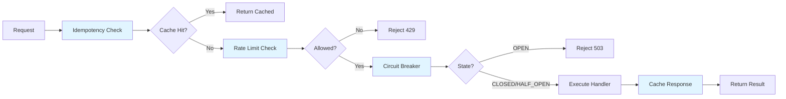

# @infrgate/control-plane

> **Zero-dependency TypeScript SDK for InfrGate control plane primitives**

[](https://www.npmjs.com/package/@infrgate/control-plane)
[](https://opensource.org/licenses/MIT)
[](https://www.typescriptlang.org/)

Build production-grade LLM gateways with **idempotency**, **rate limiting**, **circuit breaking**, and **intelligent routing** — all in a single, tree-shakeable TypeScript package with zero external dependencies.

---

## ✨ Features

- **🔒 Idempotency Guard** — SHA-256 fingerprinting with TTL replay cache for exactly-once execution semantics
- **⏱️ Token Bucket Rate Limiter** — Per-key rate limiting with linear token refill (RPM/TPM control)
- **🔄 Circuit Breaker** — State machine (CLOSED → OPEN → HALF_OPEN) with EWMA health scoring
- **📊 Execution Tracing** — 7-step gateway telemetry pipeline with per-step timing and metadata
- **🎯 Intelligent Routing** — Multi-provider ranking via composite health scores (e.g., OpenRouter → Groq → Gemini)
- **🌐 OpenAI-Compatible Client** — Drop-in replacement with automatic control plane integration

### Why This SDK?

| Feature | @infrgate/control-plane | Alternatives |
|---------|------------------------|--------------|
| **Zero Dependencies** | ✅ | ❌ (most require Redis, databases) |
| **Tree-Shakeable** | ✅ ESM + CJS | ⚠️ (mixed support) |
| **Edge Runtime Ready** | ✅ (Cloudflare Workers, Vercel Edge) | ❌ (Node.js only) |
| **Type-Safe** | ✅ Full TypeScript | ⚠️ (partial or none) |
| **Multi-Provider Routing** | ✅ Built-in scorer | ❌ (external orchestration) |

---

## 📦 Installation

```bash
npm install @infrgate/control-plane
```

**Requirements:**
- Node.js 16+ (for Web Crypto API)
- TypeScript 5.0+ (optional, but recommended)

---

## 🚀 Quick Start

### OpenAI-Compatible Client (Recommended)

```typescript
import { InfrGateClient } from '@infrgate/control-plane';

const client = new InfrGateClient({
  baseUrl: 'https://gateway.infrgate.dev',
  apiKey: 'sk_live_...',
  controlPlane: {
    rateLimit: { capacity: 60, refillRate: 1 }, // 60 RPM
    circuitBreaker: { failureThreshold: 5 },
  },
});

const response = await client.createChatCompletion({
  model: 'gpt-4',
  messages: [{ role: 'user', content: 'Explain quantum computing in simple terms' }],
});

console.log(response.choices[0].message.content);
```

### Standalone Control Plane

```typescript
import { InfrGateControlPlane } from '@infrgate/control-plane';

const cp = new InfrGateControlPlane({
  rateLimit: { capacity: 100, refillRate: 10 },
  circuitBreaker: { failureThreshold: 5 },
});

const { result, trace } = await cp.execute(
  'req_abc123',
  'tenant_xyz',
  { model: 'gpt-4', messages: [...] },
  async () => {
    return await fetch('https://api.openai.com/v1/chat/completions', {
      method: 'POST',
      body: JSON.stringify({ model: 'gpt-4', messages: [...] }),
    });
  }
);

console.log('Total duration:', trace.getTotalDurationMs(), 'ms');
console.log('Steps:', trace.toSummary());
```

---

## 🏗️ Architecture

### Control Plane Pipeline



### Multi-Provider Routing (FAST-TRACK)

```typescript
// Intelligent provider ranking based on health
const cp = new InfrGateControlPlane();

// Record metrics
cp.scorer.record('openai', 245, false);   // 245ms, success
cp.scorer.record('groq', 89, false);      // 89ms, success
cp.scorer.record('gemini', 512, true);    // 512ms, error

// Get ranked providers (best first)
const ranked = cp.rankProviders(['openai', 'groq', 'gemini']);
console.log(ranked); // ['groq', 'openai', 'gemini']

// Try providers in order
for (const provider of ranked) {
  const breaker = cp.getCircuitBreaker(provider);
  try {
    return await breaker.execute(() => callProvider(provider));
  } catch (error) {
    console.log(`${provider} failed, trying next...`);
  }
}
```

---

## 📖 API Reference

### IdempotencyGuard

Exactly-once execution semantics using SHA-256 fingerprinting.

```typescript
import { IdempotencyGuard } from '@infrgate/control-plane';

const guard = new IdempotencyGuard({ ttlSeconds: 3600 });

// Generate fingerprint
const key = await guard.fingerprint({ model: 'gpt-4', messages: [...] });

// Check cache
const cached = await guard.get(key);
if (cached) {
  return cached.body; // Replay
}

// Store response
const response = await callLLM();
await guard.set(key, response, 200);
```

**Key Methods:**
- `fingerprint(payload)` — Generate deterministic SHA-256 hash
- `get(key)` — Retrieve cached response (null if miss/expired)
- `set(key, response, statusCode)` — Store response with TTL

---

### TokenBucketRateLimiter

Per-key rate limiting with linear token refill.

```typescript
import { TokenBucketRateLimiter } from '@infrgate/control-plane';

const limiter = new TokenBucketRateLimiter({
  capacity: 60,    // 60 requests
  refillRate: 1,   // per second (60 RPM)
});

const result = await limiter.check('tenant_abc', 5); // Consume 5 tokens
if (!result.allowed) {
  return Response.json(
    { error: 'Rate limit exceeded' },
    { 
      status: 429,
      headers: { 'Retry-After': String(result.retryAfter) }
    }
  );
}
```

**Configuration:**
- `capacity` — Maximum tokens in bucket
- `refillRate` — Tokens added per second
- `keyPrefix` — Namespace for keys (default: `'ratelimit'`)

---

### ProviderCircuitBreaker

Fault tolerance with state machine and EWMA health tracking.

```typescript
import { ProviderCircuitBreaker, CircuitOpenError } from '@infrgate/control-plane';

const breaker = new ProviderCircuitBreaker('openai', {
  failureThreshold: 5,
  recoveryTimeoutMs: 30000,
});

try {
  const result = await breaker.execute(async () => {
    return await fetch('https://api.openai.com/...');
  });
} catch (error) {
  if (error instanceof CircuitOpenError) {
    console.log('Circuit open, trying fallback:', error.willRetryAt);
  }
}
```

**States:**
- `CLOSED` — Normal operation (all requests allowed)
- `OPEN` — Fail fast (requests rejected immediately)
- `HALF_OPEN` — Recovery probe (limited requests allowed)

**Key Methods:**
- `execute(fn)` — Run function with circuit breaker protection
- `getState()` — Get current state
- `recordSuccess()` / `recordFailure(error)` — Manual state updates

---

### AdapterScorer

EWMA-based health scoring for multi-provider routing.

```typescript
import { AdapterScorer } from '@infrgate/control-plane';

const scorer = new AdapterScorer(0.3); // alpha = 0.3

// Record metrics
scorer.record('openai', 245, false);   // latency, isError
scorer.record('groq', 89, false);

// Calculate scores
const openaiScore = scorer.calculateScore('openai');
const groqScore = scorer.calculateScore('groq');

// Custom weights
const customScore = scorer.calculateScore('openai', {
  availability: 0.5,
  errorRate: 0.3,
  latency: 0.2,
});
```

**Metrics:**
- `availability` — Circuit breaker state (1.0 = CLOSED, 0.0 = OPEN)
- `ewmaErrorRate` — Exponentially weighted error rate (0.0 = no errors, 1.0 = all errors)
- `ewmaLatencyMs` — Exponentially weighted latency

---

### ExecutionTraceBuilder

7-step gateway execution trace with timing and metadata.

```typescript
import { ExecutionTraceBuilder, TraceStep } from '@infrgate/control-plane';

const trace = new ExecutionTraceBuilder('req_abc123');

trace.start(TraceStep.AUTH);
// ... perform auth ...
trace.end(TraceStep.AUTH, { tenantId: 'tenant_xyz' });

trace.start(TraceStep.RATE_LIMIT);
try {
  await checkRateLimit();
  trace.end(TraceStep.RATE_LIMIT, { allowed: true, remaining: 95 });
} catch (error) {
  trace.error(TraceStep.RATE_LIMIT, error, { allowed: false });
}

// Get summary for UI
const summary = trace.toSummary();
console.log(summary);
// [
//   { step: 'auth', status: 'passed', durationMs: 2.45 },
//   { step: 'rate_limit', status: 'failed', durationMs: 0.89 }
// ]
```

**Trace Steps:**
- `AUTH` — Authentication & tenant resolution
- `RATE_LIMIT` — Token bucket checks
- `IDEMPOTENCY` — Cache replay
- `POLICY` — Spend limits & guardrails (FAST-TRACK)
- `ROUTING` — Provider selection
- `EXECUTION` — LLM API call
- `FINALIZE` — Response caching

---

## 🎯 Use Cases

### Next.js API Route with Rate Limiting

```typescript
// app/api/chat/route.ts
import { TokenBucketRateLimiter } from '@infrgate/control-plane';

const limiter = new TokenBucketRateLimiter({
  capacity: 60,
  refillRate: 1, // 60 RPM per tenant
});

export async function POST(req: Request) {
  const tenantId = req.headers.get('X-Tenant-ID') || 'anonymous';
  
  const result = await limiter.check(tenantId);
  if (!result.allowed) {
    return Response.json(
      { error: 'Rate limit exceeded' },
      { 
        status: 429,
        headers: { 'Retry-After': String(result.retryAfter) }
      }
    );
  }

  // Process request...
  return Response.json({ success: true, remaining: result.remaining });
}
```

### Multi-Provider Fallback with Circuit Breakers

```typescript
import { InfrGateControlPlane } from '@infrgate/control-plane';

const cp = new InfrGateControlPlane();

async function callWithFallback(prompt: string) {
  const providers = ['openai', 'groq', 'gemini', 'huggingface'];
  const ranked = cp.rankProviders(providers);

  for (const provider of ranked) {
    const breaker = cp.getCircuitBreaker(provider);
    
    try {
      const startTime = Date.now();
      const result = await breaker.execute(async () => {
        return await callProvider(provider, prompt);
      });
      
      // Record success
      const latency = Date.now() - startTime;
      cp.scorer.record(provider, latency, false);
      
      return result;
    } catch (error) {
      const latency = Date.now() - startTime;
      cp.scorer.record(provider, latency, true);
      console.log(`${provider} failed:`, error.message);
    }
  }

  throw new Error('All providers unavailable');
}
```

### Idempotent Webhooks

```typescript
import { IdempotencyGuard } from '@infrgate/control-plane';

const guard = new IdempotencyGuard({ ttlSeconds: 86400 }); // 24 hours

export async function POST(req: Request) {
  const webhookId = req.headers.get('X-Webhook-ID');
  const payload = await req.json();
  
  // Check for replay
  const cached = await guard.get(webhookId);
  if (cached) {
    console.log('Webhook replay detected, returning cached response');
    return Response.json(cached.body, { status: cached.statusCode });
  }

  // Process webhook
  const result = await processWebhook(payload);
  
  // Cache response
  await guard.set(webhookId, result, 200);
  
  return Response.json(result);
}
```

---

## 🔧 Configuration

### Environment Variables

The SDK uses **in-memory storage only** in v0.2.0. No external dependencies or environment configuration required.

### TypeScript Configuration

For best results, enable strict mode in `tsconfig.json`:

```json
{
  "compilerOptions": {
    "strict": true,
    "target": "ES2020",
    "module": "ESNext",
    "moduleResolution": "bundler",
    "lib": ["ES2020", "DOM"]
  }
}
```

---

## 🚨 Error Handling

### CircuitOpenError

Thrown when circuit breaker is in OPEN state:

```typescript
import { CircuitOpenError } from '@infrgate/control-plane';

try {
  await breaker.execute(handler);
} catch (error) {
  if (error instanceof CircuitOpenError) {
    console.log('Circuit open for:', error.providerName);
    console.log('Will retry at:', error.willRetryAt);
  }
}
```

### CryptoUnavailableError

Thrown if Web Crypto API is unavailable (Node.js <16):

```typescript
import { sha256 } from '@infrgate/control-plane/utils/crypto';

try {
  await sha256('hello');
} catch (error) {
  if (error.name === 'CryptoUnavailableError') {
    console.error('Requires Node.js 16+ or modern browser');
  }
}
```

---

## 📊 Performance

- **Idempotency fingerprinting**: <10ms for 10KB payloads
- **Rate limiter check**: <1ms (in-memory operations)
- **Circuit breaker state check**: <0.1ms (Map lookup)
- **Bundle size**: ~25KB minified (tree-shakeable ESM)

---

## 🛠️ Development

```bash
# Clone repository
git clone https://github.com/infrgate/infrgate.git
cd infrgate/packages/sdk

# Install dependencies
npm install

# Run tests
npm test

# Run tests in watch mode
npm run test:watch

# Build package
npm run build

# Type check
npm run typecheck
```

---

## 🗺️ Roadmap

### v0.3.0 (Planned)
- **Redis Adapters** — Distributed idempotency & rate limiting
- **Streaming Support** — SSE streaming for `InfrGateClient`
- **OpenTelemetry Integration** — Export traces to OTLP
- **Persistent Circuit Breakers** — Cross-instance state sync
- **Webhook Delivery** — Reliable event dispatching

### v0.4.0 (Planned)
- **Usage Ledger** — Token accounting & billing integration
- **Policy Engine** — Spend limits & step-up verification
- **Admin Client** — Tenant/API key management SDK

---

## 🤝 Contributing

Contributions are welcome! Please read our [Contributing Guide](../../CONTRIBUTING.md) and [Code of Conduct](../../CODE_OF_CONDUCT.md).

---

## 📄 License

MIT License - see [LICENSE](./LICENSE) for details.

---

## 🔗 Links

- **Documentation**: https://docs.infrgate.dev
- **GitHub**: https://github.com/infrgate/infrgate
- **npm**: https://www.npmjs.com/package/@infrgate/control-plane
- **Discord**: https://discord.gg/infrgate

---

**Built with ❤️ by the InfrGate Team**
